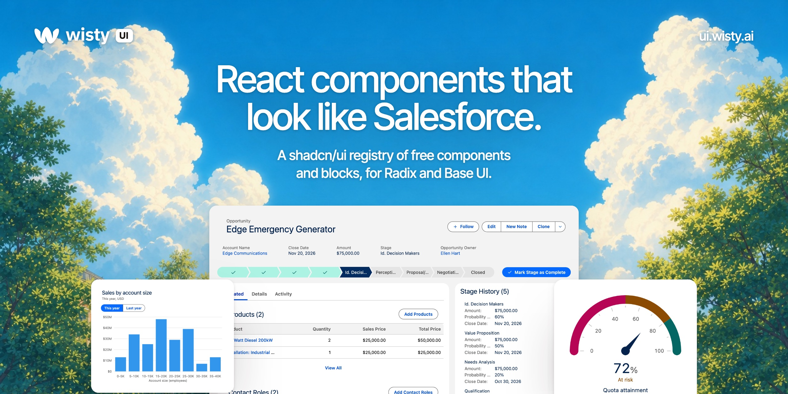

<p align="center">
  <a href="https://ui.wisty.ai">
    
  </a>
</p>

<p align="center">
  <a href="LICENSE"></a>
  <a href="https://ui.wisty.ai/docs/installation"></a>
  <a href="https://ui.wisty.ai/docs/radix-or-base-ui"></a>
  <a href="#items"></a>
</p>

<p align="center">
  <a href="https://ui.wisty.ai/docs"><b>Docs</b></a>
  &nbsp;·&nbsp;
  <a href="https://ui.wisty.ai/components"><b>Components</b></a>
  &nbsp;·&nbsp;
  <a href="https://ui.wisty.ai/blocks"><b>Blocks</b></a>
  &nbsp;·&nbsp;
  <a href="https://ui.wisty.ai/charts"><b>Charts</b></a>
  &nbsp;·&nbsp;
  <a href="https://ui.wisty.ai/docs/agents"><b>Agents and MCP</b></a>
</p>

React components in Salesforce's Lightning look (SLDS 2), built on [shadcn/ui](https://ui.shadcn.com) for Radix and Base UI projects. They're served as a shadcn registry: the shadcn CLI copies each one's source into your project. Docs, live examples in every theme and search are at [ui.wisty.ai](https://ui.wisty.ai).

This repository holds the source of the free library. It's generated from Wisty UI's own repository, so read [CONTRIBUTING.md](CONTRIBUTING.md) before opening a pull request.

## Install

Add the registry to your project's `components.json`:

```json
{
	"registries": {
		"@wisty": "https://ui.wisty.ai/r/{style}/{name}.json"
	}
}
```

Add the theme once, then add components:

```bash
npx shadcn@latest add @wisty/cosmos
npx shadcn@latest add @wisty/button
```

`@wisty/lightning-blue` and `@wisty/neutral` are the other themes. The [installation guide](https://ui.wisty.ai/docs/installation) covers Salesforce's React templates and importing the theme by hand.

## What's here

- `registry/ui/`: the primitives, shadcn's files with the same names, exports, props and variants, restyled. These are the Radix versions; `registry/base/ui/` holds the Base UI versions.
- `registry/components/` and `registry/blocks/`: what shadcn lacks, and assemblies of both. One file serves Radix and Base UI projects.
- `registry/hooks/`: hooks a primitive imports.
- `registry/themes/`: `tokens.css`, the token names every item reads, and the Cosmos, Lightning Blue and Neutral themes.

Each item's folder has a `README.md`: when to use it, its rules, its API reference and the code of every example.

## Items

### Components

| Item | Kind | Description |
| --- | --- | --- |
| [Accordion](registry/ui/accordion) | Primitive | Stacks titled sections that expand to show content, one or several at a time. |
| [Alert](registry/ui/alert) | Primitive | Tells people about part of the page, with an icon, a title and an action. Also the page-wide banner. |
| [Alert dialog](registry/ui/alert-dialog) | Primitive | Asks a question people must answer before going on, like confirming a delete. |
| [Avatar](registry/ui/avatar) | Primitive | Shows a person or record as a picture or initials. |
| [Badge](registry/ui/badge) | Primitive | Labels a status or a count in a short chip. |
| [Breadcrumb](registry/ui/breadcrumb) | Primitive | Shows where a page sits in a hierarchy, with links back up. |
| [Button](registry/ui/button) | Primitive | Runs an action on the page, like Save, Edit or New. |
| [Button group](registry/ui/button-group) | Primitive | Joins related buttons into one control, like a record's Edit, Clone and More. |
| [Calendar](registry/ui/calendar) | Primitive | Shows a month of days to pick a date or a range. |
| [Card](registry/ui/card) | Primitive | Groups related content and actions in a titled container. |
| [Carousel](registry/ui/carousel) | Primitive | Shows one image panel at a time, with dots or arrows to move between them. |
| [Chart](registry/ui/chart) | Primitive | Draws bar, line, area, donut, scatter and funnel charts. One config names each series and its color, and the tooltip and legend read it. |
| [Chart legend](registry/components/chart-legend) | Component | Lists a chart's series with their values beside it, or the sizes of its bubbles. |
| [Checkbox](registry/ui/checkbox) | Primitive | Turns one option on or off, or shows a mixed state for a group. |
| [Collapsible](registry/ui/collapsible) | Primitive | Shows and hides a block of content from a trigger, like a record's details. |
| [Combobox](registry/ui/combobox) | Primitive | Filters a list of options as you type, for one value or several shown as pills. |
| [Command](registry/ui/command) | Primitive | Jumps to records, pages and commands from the keyboard, filtering as you type. For a form field, use Select or Combobox. |
| [Context menu](registry/ui/context-menu) | Primitive | Opens a menu of actions on right-click, like on a file tile or a list row. |
| [Data table](registry/components/data-table) | Component | Shows records in a table that sorts, selects, runs row actions and loads more. Formats typed columns: currency, percent, dates, links, addresses. |
| [Date picker](registry/components/date-picker) | Component | Picks a day, typed in the field or chosen from a calendar under it. Holds a day with no time, like a Date field. |
| [Datetime picker](registry/components/datetime-picker) | Component | Picks a date and a time, typed or chosen from a calendar and a list. Holds a local date and time, like a Date/Time field. |
| [Dialog](registry/ui/dialog) | Primitive | Opens a window over the page for a short task or a message that needs an answer. |
| [Dropdown menu](registry/ui/dropdown-menu) | Primitive | Opens a menu of actions or options from a button, like a record's row actions. |
| [Dual listbox](registry/components/dual-listbox) | Component | Picks several options by moving them from one list to another, in order. For a short list of choices, use Checkbox or Combobox. |
| [Dynamic icon](registry/components/dynamic-icon) | Component | Shows a small animated status, like a calculation running or a score's strength. For an indefinite wait, use Spinner. |
| [Empty](registry/ui/empty) | Primitive | Says a list, table or panel has nothing in it yet, and what to do next. |
| [Expandable section](registry/components/expandable-section) | Component | Opens and closes a titled section of a page from its gray title bar. Closed content stays mounted, hidden. |
| [Field](registry/ui/field) | Primitive | Lays out a form control with its label, help text and error. |
| [File selector](registry/components/file-selector) | Component | Picks files with an Upload Files button or by dropping them on the field. The app uploads the files it picks. |
| [Hover card](registry/ui/hover-card) | Primitive | Previews a linked record or person while the pointer rests on the link. |
| [Icon](registry/components/icon) | Component | Shows a Salesforce icon. Object icons sit on their own color, and utility icons take the text color. |
| [Input](registry/ui/input) | Primitive | Takes a single line of text. |
| [Input group](registry/ui/input-group) | Primitive | Puts icons, text or buttons inside an input or textarea. |
| [Item](registry/ui/item) | Primitive | Shows one entry as a row with an icon, a title, a description and actions. |
| [Kbd](registry/ui/kbd) | Primitive | Shows a key or a keyboard shortcut, like Ctrl S. |
| [Label](registry/ui/label) | Primitive | Names a form control. |
| [Linear scale](registry/components/linear-scale) | Component | Picks one number from a row, like 0 to 10, with words under the two ends. For stars or hearts, use Rating. |
| [Lookup](registry/components/lookup) | Component | Picks records from a search, one in the field or several as pills. Searches records you pass, or a search you run. |
| [Markdown](registry/components/markdown) | Component | Shows markdown text as formatted prose, like an AI answer or summary. People can't edit it, and embedded HTML shows as text. |
| [Menubar](registry/ui/menubar) | Primitive | Keeps a row of menus on screen, like an editor's File, Edit and View. |
| [Metric](registry/components/metric) | Component | Shows one number with its name, a unit and a trend colored good or bad. |
| [Native select](registry/ui/native-select) | Primitive | Picks one option with the browser's own select. |
| [Number input](registry/components/number-input) | Component | Enters a quantity, an amount or a percent in the locale's number format. Leave out the minus and plus buttons for a number nobody steps. |
| [Output field](registry/components/output-field) | Component | Shows a field's label and formatted value read-only, with an edit pencil. |
| [Page header](registry/components/page-header) | Component | Titles a page with its icon, actions, meta text and key details. For a record or a list, start from Record header or List view header. |
| [Page regions](registry/components/page-regions) | Component | Gives a page the layout of a Lightning page template: a header, then regions. The template sets the columns and where they stack. |
| [Pagination](registry/ui/pagination) | Primitive | Moves between pages of a long list. |
| [Path](registry/components/path) | Component | Shows a record's stages as chevrons, with the current one and an action. |
| [Pill](registry/components/pill) | Component | Shows a removable token for a record or a selected value, alone or in a list. |
| [Popover](registry/ui/popover) | Primitive | Shows details or a short form in a panel anchored to a trigger. The page stays usable behind it. |
| [Progress](registry/ui/progress) | Primitive | Shows how far a task has come, from 0 to 100%. |
| [Progress indicator](registry/components/progress-indicator) | Component | Shows the steps of a wizard or setup flow and which one people are on. For a record's stages, use Path. |
| [Progress ring](registry/components/progress-ring) | Component | Shows how much of a task is done as a small ring that fills from 0 to 100. For a value against a target, use Gauge. |
| [Radio group](registry/ui/radio-group) | Primitive | Picks exactly one option from a short list that stays visible. |
| [Rating](registry/components/rating) | Component | Picks a score from a row of stars or other icons that fill up to the choice. To show a score, use Gauge. |
| [Scroll area](registry/ui/scroll-area) | Primitive | Scrolls its content in a fixed-size box, with slim scrollbars. |
| [Select](registry/ui/select) | Primitive | Picks one value from a short list in a dropdown, as a picklist does. |
| [Separator](registry/ui/separator) | Primitive | Draws a thin line between groups of content. |
| [Sheet](registry/ui/sheet) | Primitive | Slides a panel in from the edge of the screen for a task beside the page. |
| [Sidebar](registry/ui/sidebar) | Primitive | Lays out an app's side navigation, with groups, a header and a footer. Collapses, and becomes a sheet on small screens. |
| [Skeleton](registry/ui/skeleton) | Primitive | Holds the place of content while it loads. |
| [Slider](registry/ui/slider) | Primitive | Picks a number or a range by dragging a thumb along a track. |
| [Sonner](registry/ui/sonner) | Primitive | Shows brief, non-blocking messages, like a saved record or a failed request. |
| [Spinner](registry/ui/spinner) | Primitive | Shows that something is loading. |
| [Switch](registry/ui/switch) | Primitive | Turns a setting on or off at once. |
| [Table](registry/ui/table) | Primitive | Shows rows of data in columns, read-only. For sorting, selection and row actions, use Data table. |
| [Tabs](registry/ui/tabs) | Primitive | Switches between panels of related content. |
| [Textarea](registry/ui/textarea) | Primitive | Takes text over several lines, like a description or a comment. |
| [Time picker](registry/components/time-picker) | Component | Picks a time of day, typed in the field or chosen from a list of times. Holds a time with no date, like a Time field. |
| [Toggle](registry/ui/toggle) | Primitive | Stays pressed until it's pressed again, like Bold in a text editor. |
| [Toggle group](registry/ui/toggle-group) | Primitive | Joins toggles in a row, one or several pressed, like Day, Week and Month. |
| [Tooltip](registry/ui/tooltip) | Primitive | Shows a short hint about a control while it has hover or keyboard focus. |
| [Tree](registry/components/tree) | Component | Shows a hierarchy people open level by level and pick one item from. For rows with columns, use Data table. |
| [Visual picker](registry/components/visual-picker) | Component | Picks one or several options shown as large cards with an icon or text. For plain choices, use Radio group or Checkbox. |

### Blocks

| Item | Kind | Description |
| --- | --- | --- |
| [Activity timeline](registry/blocks/activity-timeline) | Block | A record's tasks, events, calls and emails in time order, with their details. The Activity tab of a record page. |
| [KPI row](registry/blocks/kpi-row) | Block | A dashboard's header row: key figures on one card, each with its change. |
| [List view](registry/blocks/list-view) | Block | A list of records: list views, search and a table to sort and select. Lightning's object home, for a standard or custom object. |
| [List view header](registry/blocks/list-view-header) | Block | The top of a list page, where people switch list views, search and act. The header of Lightning's object home, for a standard or custom object. |
| [Metric trend](registry/blocks/metric-trend) | Block | A dashboard's lead chart: metrics as tabs, the selected one's trend below. Each can compare with an earlier period. |
| [Record detail](registry/blocks/record-detail) | Block | A record's Details tab, read-only, for a standard or custom object. Same field descriptions as Record form and Record inline edit. |
| [Record form](registry/blocks/record-form) | Block | Lightning's New and Edit record form, with required checks and save errors. The app does the saving. |
| [Record header](registry/blocks/record-header) | Block | The top of a record page: its name, key fields and actions. Lightning's highlights panel, for a standard or custom object. |
| [Record inline edit](registry/blocks/record-inline-edit) | Block | A record's Details tab, edited in place with a pencil, Cancel and Save. The app does the saving. |
| [Record page](registry/blocks/record-page) | Block | A record page for a standard or custom object, with its header, tabs and sidebar. A page file you edit, with no props. |
| [Related list](registry/blocks/related-list) | Block | A record's related records of one kind, with New and View All. Lightning's related list, for a standard or custom object. |

### Charts

| Item | Kind | Description |
| --- | --- | --- |
| [Bar list](registry/components/bar-list) | Component | Ranks labeled values with a bar under each on one scale, with shares of a total. Rows can link to records or toggle to filter a page. |
| [Gauge](registry/components/gauge) | Component | Shows one value against a maximum, as a dial, a ring, a bar or a row of dots. Optional ranges color the scale. |

## License

Wisty UI's code is under the MIT License in [LICENSE](LICENSE). The Cosmos, Lightning Blue and Neutral theme files, the animations in `tokens.css` and the icon color map contain values from Salesforce's Lightning Design System 2, which aren't under the MIT License. [THIRD_PARTY_NOTICES.md](THIRD_PARTY_NOTICES.md) lists what comes from Salesforce, shadcn and Tailwind, with Salesforce's Terms of Use in full. The icons aren't in this repository: your app copies them from `@salesforce-ux/icons`, as Icon's page says.

Wisty UI is made by [Wisty](https://wisty.ai). It is not made, sponsored or endorsed by Salesforce, Inc. Salesforce and Lightning are trademarks of Salesforce, Inc.
